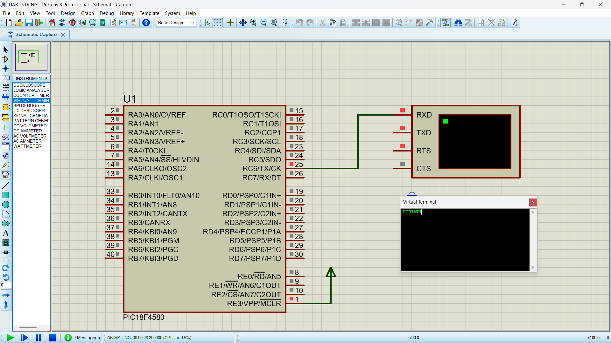

# PIC18F4580 UART Communication

## 📌 Overview
This project explores UART (Universal Asynchronous Receiver/Transmitter) serial communication using the PIC18F4580 microcontroller and Embedded C.

## 🎯 Objectives
- Understand UART serial communication.
- Configure the PIC18F4580 USART peripheral.
- Transmit characters and strings over UART.
- Receive serial data and process incoming characters.
- Explore serial communication through Proteus simulation.

## 🛠️ Tools and Technologies
- **Microcontroller:** PIC18F4580
- **Programming Language:** Embedded C
- **IDE/Compiler:** MPLAB with the compiler actually used
- **Simulation:** Proteus ISIS

## ⚙️ UART Configuration
- **Communication:** Asynchronous serial
- **Baud Rate:** 9600 bps, if configured in your program
- **TX Pin:** RC6/TX
- **RX Pin:** RC7/RX

## 📚 Concepts Practiced
- USART registers: TXSTA, RCSTA, SPBRG, TXREG, and RCREG
- Serial data transmission and reception
- Baud-rate configuration
- UART receive flags and interrupt concepts, where implemented

  ## 🔌 Circuit Diagram

## 👨‍💻 Author
Piyush Gondane
